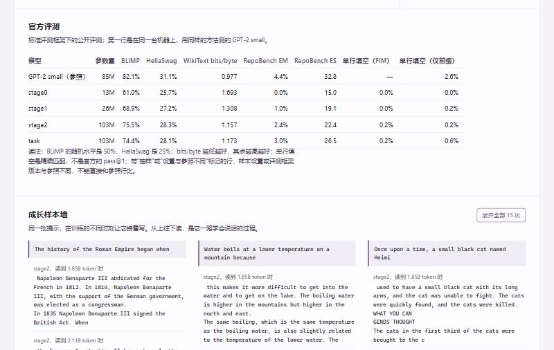
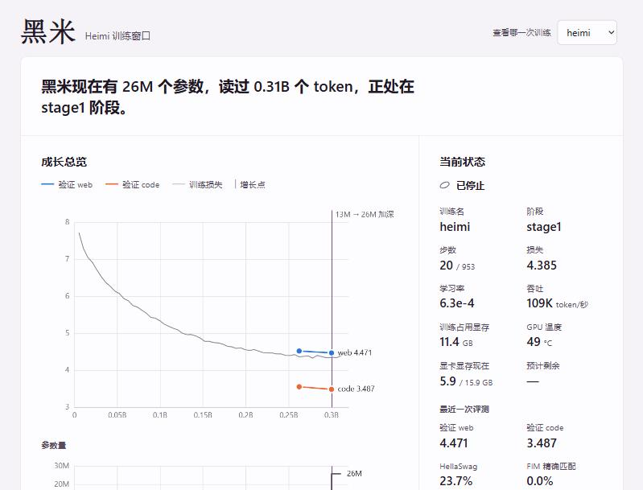

# 黑米 · Heimi — a mini DeepSeek-style language model, grown from scratch

Heimi is a **~103M-parameter dense language model** built and trained from zero on a single
**laptop RTX 5080 (16 GB)**, in hand-written PyTorch — no `transformers`, no Megatron, no cloud.
It is a learning project with a real, measurable result — not a product, and not state-of-the-art.

What makes it unusual: the model is **grown**, not trained at one fixed size. It starts at 13M
parameters, then doubles in depth (13M → 26M) and in width (26M → 103M) using
**function-preserving** growth operators (LLaMA-Pro block expansion for depth, HyperCloning for
width), so each jump keeps the logits it had already learned and training continues without a loss
spike. After the growth ladder it is fine-tuned into an **offline single-line code / shell
completion** model with Fill-in-the-Middle.

> Named after the author's black cat, 黑米 ("Heimi").

---

## Results — measured on a public yardstick, next to GPT-2 small

Every number below comes from the open [lm-evaluation-harness](https://github.com/EleutherAI/lm-evaluation-harness)
(v0.4.13) plus RepoBench / single-line infilling, run **on the same machine, the same harness, the
same sample sizes and the same code** as the reference. Heimi's numbers may **only** be compared
with this GPT-2 row — not with papers or leaderboards (float32 scoring, greedy decoding, 500-sample
code subsets; the exact protocol and its five deviations are in
[docs/official-eval.md](docs/official-eval.md)).

| Benchmark | chance | GPT-2 small · 85M | **Heimi · 103M** |
|---|:---:|:---:|:---:|
| BLiMP — grammar ↑ | 0.50 | **0.82** | 0.74 |
| HellaSwag — acc_norm ↑ | 0.25 | **0.31** | 0.28 |
| WikiText — bits/byte ↓ | — | **0.98** | 1.17 |
| RepoBench — next-line EM ↑ | — | 0.044 | **0.10** |
| RepoBench — next-line ES ↑ | — | 32.4 | **55.1** |
| Single-line infill — EM ↑ | — | 0.026 | **0.096** |

**Honest read:** GPT-2 small (2019) still beats Heimi on general English — grammar and language
modeling. Heimi beats GPT-2 on **code completion**, because Heimi was trained on code and GPT-2
mostly was not. So the headline is *"a from-scratch 103M model that clearly learned language and
learned code,"* not *"a new best model."* GPT-2 small (85M non-embedding params) is the reference
because it sits in the same size class as Heimi's final stage (103M).



---

## An honest negative result

The project's second success criterion asked: *does the growth ladder reach a from-scratch model's
final loss in fewer tokens than just training 103M from scratch?* It **did not**. A plain
from-scratch 103M baseline matched the ladder's validation loss with about **half** the tokens; the
ladder needed roughly **2× the tokens** and 1.2–1.6× the GPU time for the same web loss (one run,
one seed each; growth noise and learning rate left untuned, so the cause is unverified). The
growth math itself worked — depth growth was bitwise-exact and width growth had a maximum relative
error of 6e-4 with symmetry-breaking noise. The full comparison is in
[docs/training/ladder-vs-baseline-report.md](docs/training/ladder-vs-baseline-report.md).

Negative results are results. This one is kept in the repo on purpose.

---

## What's inside

- **DeepSeek-V2-Lite-style dense skeleton** — MLA attention, RMSNorm, SwiGLU, pre-norm — written by hand in PyTorch.
- **Function-preserving growth** — depth via LLaMA-Pro zero-init blocks, width via HyperCloning (tile + ½, tiny symmetry-breaking noise).
- Own **16k byte-level BPE** tokenizer; English + code only (FineWeb-Edu + github-code-clean).
- A four-stage training **ladder** (`stage0 → stage1 → stage2 → task`) driven by one YAML; checkpoints and JSONL logs under `runs/`.
- A local web **dashboard** (FastAPI, single page) showing live training, the effect of each growth step, a sample wall, and a playground that runs any checkpoint.
- A reproducible **official-eval** command that scores any checkpoint against the GPT-2 reference.



---

## Repository layout

```
minids/            model, growth, data pipeline, training, eval, official-eval
train.py           run the growth ladder (or the baseline) from a YAML
official_eval.py   score checkpoints on public benchmarks vs GPT-2
dashboard.py       local web dashboard (127.0.0.1:8787)
complete.py        single-line / FIM completion from a trained checkpoint
sample.py          free-form generation from a checkpoint
configs/           ladder.yaml, baseline105m.yaml, baseline105m_task.yaml
docs/              design spec, plans, and data/training/eval reports (in Chinese)
tests/             357 tests
```

The repo ships **code and docs, not data or weights** — `data/`, `runs/` and `models/` are
gitignored. You rebuild them with the steps below.

---

## Reproduce

Windows 11, Python 3.12, an NVIDIA GPU. Install a **CUDA build** of PyTorch from the official index
(a `torch *+cpu` wheel cannot train), then install the package:

```
uv venv
uv pip install -e ".[dev,official]"
uv pip install torch --index-url https://download.pytorch.org/whl/cu128   # match your CUDA
```

Build the token shards (CPU, roughly an hour; downloads ~24 GB of parquet):

```
python -m minids.data.download  --source all --root data
python -m minids.data.prepare   val-rows --root data --out data/tokens/val_rows.json
python -m minids.data.tokenizer train --root data --out data/tokenizer/heimi-16k.json --val-rows data/tokens/val_rows.json
python -m minids.data.prepare   run --root data --tokenizer data/tokenizer/heimi-16k.json --val-rows data/tokens/val_rows.json --source all
```

Train the ladder (~15 GPU-hours on a 16 GB laptop GPU), watch it, and score it:

```
python train.py         --config configs/ladder.yaml --run heimi --device cuda
python dashboard.py     --runs runs/                               # http://127.0.0.1:8787
python official_eval.py --run heimi                                # needs the [official] extra
```

Tests: `python -m pytest -q -W error` — 357 passing.

---

## Status (against the design spec, `docs/superpowers/specs/`)

- ✅ Function-preserving growth, no loss spike at the growth points *(criterion 1)*
- ❌ Growth cheaper than from-scratch in tokens *(criterion 2 — see the negative result above)*
- ✅ Measurable single-line FIM after the task stage; grammatical English on fixed prompts *(criterion 3)*
- ✅ Live dashboard that training does not depend on *(criterion 4)*
- ✅ All 357 unit / smoke tests pass *(criterion 5)*

---

## License

No license yet — **all rights reserved** until the author adds one. To let others reuse the code,
add a `LICENSE` (e.g. MIT). Note that the datasets and `lm-evaluation-harness` carry their own
licenses, which this repo does not override.

---

## Credits

Data: **FineWeb-Edu** (sample-10BT) and **github-code-clean**. Benchmarks: EleutherAI
**lm-evaluation-harness**, **RepoBench**, and HumanEval-style single-line infilling. Reference
model: **GPT-2 small** (`openai-community/gpt2`). Model design follows **DeepSeek-V2-Lite**; growth
operators follow **LLaMA-Pro** (depth) and **HyperCloning** (width). Built on a laptop with Claude Code.
