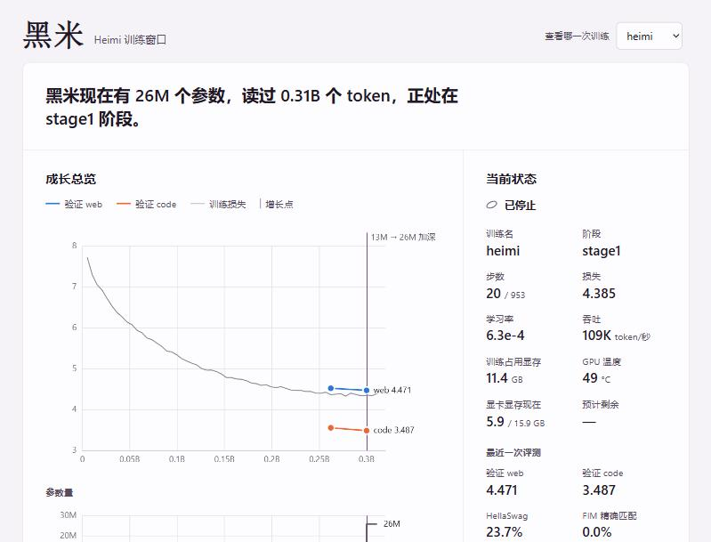
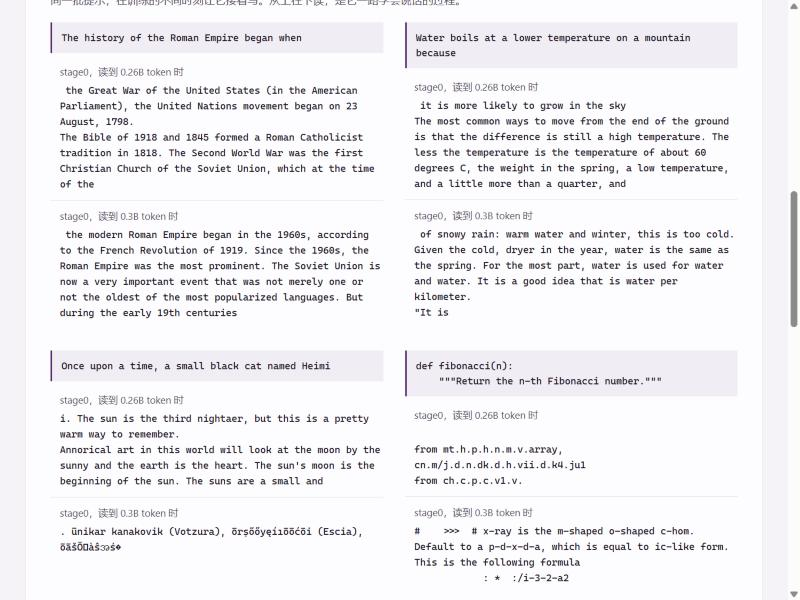
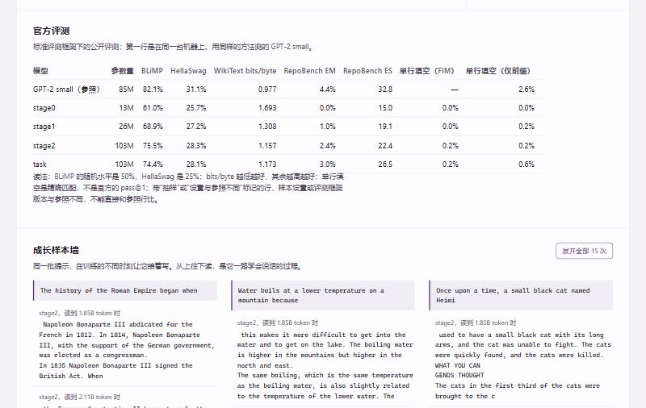
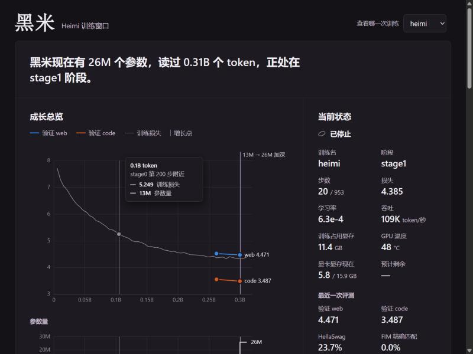

# 黑米的训练窗口

一个只在本机打开的网页，训练时开着就能看它长大。它只读 `runs/` 下的日志和检查点，不写任何东西，开着不影响训练。



## 启动

```
python dashboard.py --runs runs/
```

浏览器会自动打开 `http://127.0.0.1:8787`。页面每 5 秒自己刷新一次。

| 参数 | 默认 | 说明 |
|---|---|---|
| `--runs` | `runs` | 训练输出目录，里面每个子目录是一次训练 |
| `--port` | `8787` | 端口 |
| `--no-browser` | 关 | 不自动打开浏览器 |

服务只绑 `127.0.0.1`，别的机器访问不到；它也只接受以 `127.0.0.1` 或 `localhost` 为地址的请求，所以你开着窗口时浏览到的其他网页冒用不了它。还没有任何训练记录时也能打开，页面会提示先去开始一次训练。

## 五个区域

**成长总览。** 横轴是累计读过的 token，纵轴是损失。细灰线是训练损失，蓝色与橙色带点的线是 web 与 code 两份验证集上的损失。每次增长处有一条竖线，顶上写着 "13M → 26M 加深" 这样的标注。下面一张小图是参数量的阶梯。把鼠标移到图上会出现一条竖线和一个提示框；移到评测点附近会吸过去并列出两条验证损失。焦点在图上时，左右方向键在评测点之间移动。图下面可以展开一张表，评测的全部数字都在里面。

对照组训练出来之后（run 名以 `baseline` 开头，按 spec 用 `baseline105m`），它的两条验证损失会以虚线叠在同一张图上。

**当前状态。** 正在看的这次训练的阶段、步数、损失、学习率、吞吐、显存、GPU 温度、预计剩余时间和最近一次评测。状态有三档：

| 显示 | 含义 |
|---|---|
| 训练中 | 最近 3 分钟内写过日志 |
| 评测中或暂停 | 3 到 30 分钟没写日志。每级结束时的评测最长约 20 分钟，期间不写指标，所以不直接判成停止 |
| 已停止 | 超过 30 分钟没动静 |

如果你正在看的不是正在训练的那一次，顶栏会出现一个按钮，点一下切过去。

**成长样本墙。** 六条固定提示各占一列，往下是训练过程中每隔 500 步让它接着写的结果，旧的在上、新的在下。默认只显示最近 8 次，可以展开全部。



**试玩台。** 自己写前缀让它接。后缀留空是普通续写；填了后缀就是填空，它只补中间那一行。可以选任意一次训练的任意检查点，勾选"并排比较"再选第二个检查点，就能看同一个开头在两个阶段分别写成什么样。

**官方评测。** 一张表，把黑米每个阶段的检查点和同一台机器上测出来的 GPT-2 small 放在一起：第一行是 GPT-2（参照），后面每个评过的检查点一行，按训练进度排。列是参数量、BLiMP、HellaSwag、WikiText bits/byte、RepoBench 的 EM 与 ES、单行填空的 FIM 与仅前缀。表下一句话写着随机水平和每列是越高还是越低越好。每个数字的意思、怎么运行见 [`official-eval.md`](official-eval.md)。



行名后面可能带标记：

| 标记 | 含义 |
|---|---|
| （抽样） | 这一行的三个标准任务只评了一部分题（用了 `--limit`）。参照行也可能带这个标记 |
| （设置与参照不同） | 这一行全量评了，但它的评测设置或评测框架版本和参照行不一样，不能直接和参照行比 |
| （无代码评测） | 这一行没有跑代码评测（用了 `--skip-code`），代码的几列显示 "—" 而不是 0 |

没有结果时，这一格显示怎么运行：`python official_eval.py --run <run 名>`（训练停着的时候）。如果官方评测的记录文件读不出来，只有这一格显示"官方评测记录读不出来，其他区域不受影响"，别的区域照常。这个区域和别的一样只读：窗口不会创建或修改 `official.jsonl`，它只由命令写。

## 关于试玩台的几件事

- 生成在一个独立的后台进程里跑，默认用 CPU，不占训练用的显卡。它最多同时记住 2 个模型。
- 一次生成超过 60 秒会被放弃，后台进程会自动重启，下一次请求不受影响。13M 和 26M 的模型在 CPU 上一两秒就出结果；105M 的模型配上很长的前缀可能超时，这时在不训练的时候把设备改成 GPU。
- 训练进行中不要选 GPU：显卡的显存要留给训练。有训练在跑时选 GPU，页面会先提醒一句。
- 检查点先在内存里加载，只有模型本身上显卡。用过 GPU 的后台进程空闲 3 分钟后会自己退出，把显存还回去，所以玩过 GPU 再开训练不用关窗口，等几分钟就行。
- 模型写出来的任何内容都按原文显示，它补出 `<script>` 之类的代码也不会被浏览器执行。
- 试玩台正在读某个检查点、训练恰好要重写同一个文件时，训练会等它读完再写（最多等 30 秒），不会因此中断。

## 日志不完美的时候

训练进程只往日志末尾追加，所以有几种情况窗口会替你收拾：

- **中断后从更早的检查点恢复。** 同一段步数会在日志里写两遍，窗口只画后写的那一遍；开着的页面发现步数倒退了，会自己重新取一遍数据。
- **同一级进了两次**（开头 500 步内被打断，还没有检查点）。增长竖线只画一条。
- **对旧检查点重跑 `evaluate.py`。** 结果并进同一步的评测点里：新算出的数覆盖旧的，没算的项（比如加了 `--no-hellaswag`）保留原来的数。"最近一次评测"按训练进度算，不按写入先后。
- **某次训练的日志中间坏了一行**（比如断电）。只有那一次训练看不了，页面会写明是哪个文件；其他训练照常显示。把坏掉的那一行删掉或把文件移走即可恢复。

## 深色模式

页面跟随系统的明暗设置。



## 文件

| 文件 | 作用 |
|---|---|
| `dashboard.py` | 入口，转发到 `dashboard/cli.py` |
| `dashboard/data.py` | 读日志与检查点目录，整理成页面要的数据 |
| `dashboard/worker.py` | 生成用的后台进程 |
| `dashboard/server.py` | 接口 |
| `dashboard/static/index.html` | 页面本身，样式与脚本都在里面 |
| `dashboard/static/chart.umd.min.js` | Chart.js 4.6.1（MIT 许可），随仓库分发，页面不访问外网 |

接口一览：`GET /api/runs`、`/api/runs/{run}/metrics?since=`、`/eval`、`/events`、`/samples`、`/overview`、`/official`、`GET /api/status?run=`、`POST /api/generate`。
